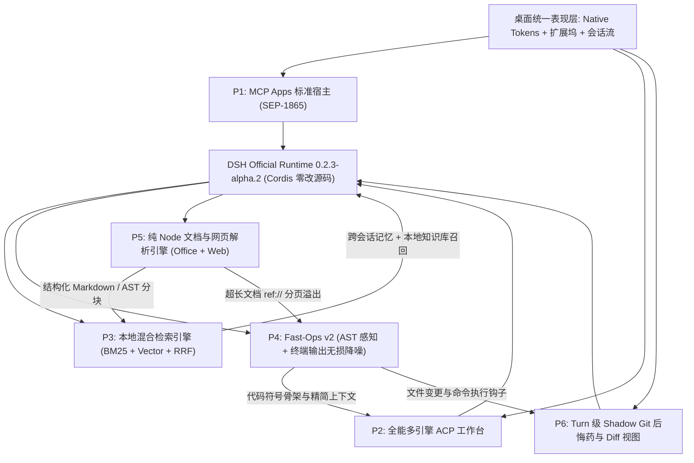
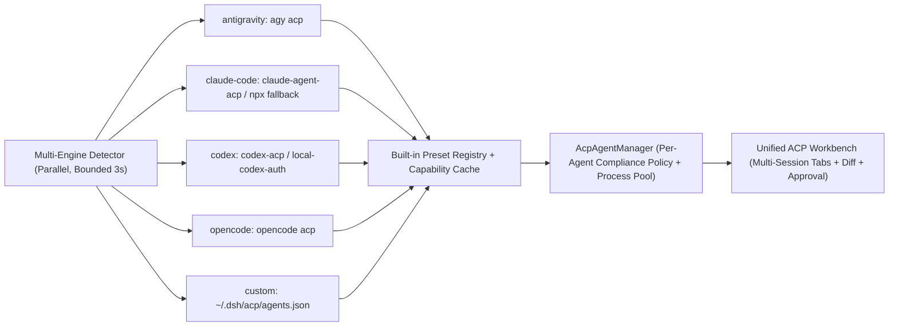
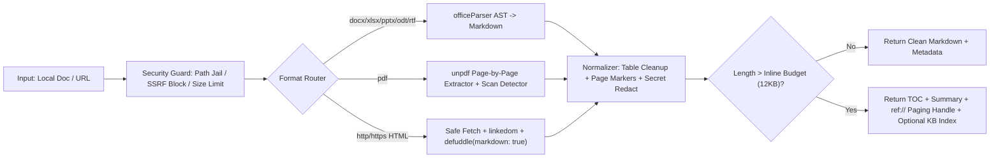
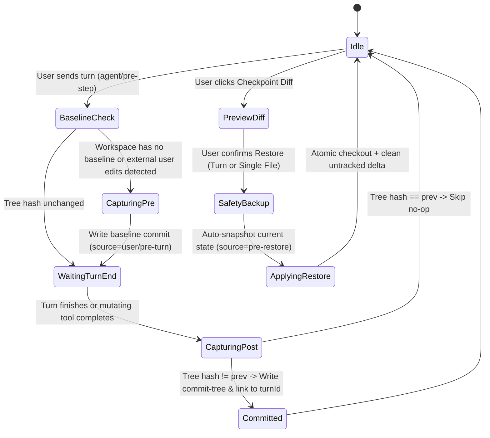
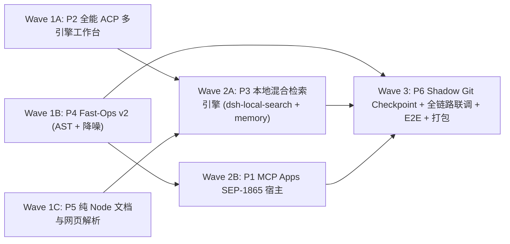

# DeepSeek Harness Desktop 社区版 5.7 底座重构与六大核心能力总体规划

- **作者 / 维护者**：`ningbainb`
- **适用仓库**：`ningbainb/deepseek-harness-desktop`（基于官方 DSH Runtime `0.2.3-alpha.2`、Node `>=24.9.0`、Electron `44.7.0`）
- **命名空间约定**：所有新建第一方插件目录统一以 `dsh-` 开头，NPM 包名统一署名 `@ningbainb/dsh-*`（既有包原地演进）
- **文档定位**：面向顶级编码模型的**可执行主架构规范（Master Engineering Specification）**。实施模型须在每个阶段编码前完成指定开源项目的源码级调研与算法比选，严格遵守零改官方源码、零 Emoji、原生 UI Token、事务可回滚与量化性能门禁。

---

## 0. 顶层架构总览与实施宪法

### 0.1 为什么要把这 6 项做成“统一底座”而不是 6 个孤立插件

在 5.6.0 已完成 `dsh-fast-ops`、`dsh-win-control`、`dsh-im-hub`、`dsh-chat-artifacts`、`dsh-agent-inbox`、Work Mode 连接器与首版 ACP 客户端的基础上，5.7 的目标不是“堆功能”，而是打通 **协议层 -> 智能体编排层 -> 认知与代码理解层 -> 安全回滚层** 的完整闭环：



这 6 项之间存在强协同效应：
1. **P5（文档/网页解析）直接喂给 P3（本地混合检索）和 P4（`ResultCache` `ref://` 分页）**：一份 200 页 PDF 不会炸穿上下文，既能按 `ref://` 精准翻页，也能一键入库做混合检索。
2. **P4（AST + 降噪）直接赋能 P2（多引擎工作台）和性价比模式**：上下文噪音砍掉 60% 以上，主控模型与外部 ACP Agent 都能更便宜、更精准。
3. **P6（Shadow Git Checkpoint）托底 P1 / P2 / P4 的全部文件写入**：无论 DeepSeek、Claude Code、Codex 还是 OpenCode 改坏代码，任意轮次一键恢复，且绝不污染用户真实的 `.git` 历史。

### 0.2 实施模型必须遵守的 7 条架构铁律

1. **零修改官方源码**：所有扩展只通过 `@deepseek-ai/*` 公开 NPM SDK、`cordis.patch.yml`、Desktop 宿主适配层挂载；严禁出现指向官方源码 checkout 的路径引用。
2. **先多方调研、后落代码（Research-First Mandate）**：每个 Pillar 开始实现前，必须查阅所列开源参考项目的最新协议文档/源码实现与许可证（MIT / Apache-2.0 / ISC），在对应包内保留 `NOTICE` / `README.zh.md` 致谢与差异说明，严禁机械照搬已知缺陷（如 Cline 的 `.git_disabled` 重命名缺陷）。
3. **纯 Node 24 / TS 优先，零重型外置服务**：不引入 Python 运行时、Docker、独立向量数据库进程（禁止要求用户启动 Chroma / Qdrant / Milvus）。原生扩展（`@ast-grep/napi`、`sqlite-vec`）必须具备 `asarUnpack` 路径策略与纯 TS 降级兜底。
4. **统一原生 UI 语言与美学标准**：复用 5.6.0（提交 `2b324e8b`）确立的原生设计系统——全部颜色与表面使用 `--dsw-alias-label-primary`、`--dsw-alias-label-secondary`、`--dsw-alias-label-tertiary`、`--dsw-alias-bg-module-platform`、`color-mix(in srgb, ...)`；无框化拓展坞卡片、克制间距、平滑状态过渡、完整深浅色与 15 套皮肤兼容、键盘无障碍焦点、完整中英文双语 `locales.ts`。
5. **绝对禁止 Emoji**：代码、注释、UI 文案、文档、提交信息全仓库严禁出现任何 Unicode Emoji 字符。
6. **数据主权与崩溃安全**：所有持久化元数据采用原子写（临时文件 + `rename`），索引类数据（SQLite / Orama 快照）定位为**可从原始 JSON/Markdown 源重建的派生索引**，损坏时自动隔离备份并后台重建，绝不静默丢数据。
7. **功能保全与增量验证**：严格保留既有入口、配置字段与测试断言；迭代期使用 `electron src/main.mjs` 跑针对性单测与 Playwright E2E，全部收官后执行一次完整打包与本地测试版 staging。

---

## Pillar 1：升级 `dsh-chat-artifacts` 为完整 MCP Apps（SEP-1865）标准宿主

- **归属包**：演进现有 `@ningbainb/dsh-chat-artifacts`（[packages/dsh-chat-artifacts](../../packages/dsh-chat-artifacts/package.json)），避免拆分出重复的 iframe 沙箱宿主导致消息监听与主题桥接分裂。
- **核心目标**：在 100% 兼容现有内联 HTML/CSS/SVG Artifact 的前提下，成为完整的 **MCP Apps（SEP-1865）标准宿主**，支持渲染任意 MCP Server 声明的 `ui://` 交互式应用，并建立受控、可审计的双向 JSON-RPC 通道。

### 1.1 多方开源调研清单

| 参考项目 | 协议 | 重点学习与复用维度 | 规避风险 |
| --- | --- | --- | --- |
| `@modelcontextprotocol/ext-apps`（SEP-1865 官方 SDK） | MIT | 协议消息体定义（`ui/initialize`、`ui/notifications/initialized`、`ui/callServerTool`、`ui/updateModelContext`、`ui/openLink`、`ui/sizeChanged`、`ui/notifications/tool-input`、`ui/notifications/tool-result`、`ui/notifications/host-context-changed`） | 不要把宿主侧做成宽松通配 `postMessage('*')`，必须严格校验 `event.source` 与会话级 `bridgeToken` |
| `sugarforever/dsh-mcp-apps` / `openma-ai/dsh-mcp-apps` | MIT | Cordis 双端插件如何监听 MCP 工具元数据 `_meta.ui.resourceUri`、从 MCP Server 读取 `ui://` 资源并注入客户端渲染槽位 | 避免另起一套外部网络代理或绕过 `ctx.approval` 的直通工具调用 |
| 现有 `SafeArtifactFrame.tsx` 与 `frame-document.ts` | 本仓 | 复用 `IntersectionObserver` 懒卸载、`useArtifactTheme` 无重载主题同步、CSP 策略与流式节流机制 | 严格区分静态 Artifact 与 MCP App 的权限域，MCP App 默认严禁外网 `fetch`/`img` 直连除非显式声明 CSP 白名单 |

### 1.2 协议时序与安全沙箱架构

```mermaid
sequenceDiagram
    participant Model as DSH Agent
    participant Host as Host MCP Apps Bridge
    participant MCP as External MCP Server
    participant UI as Chat UI Host Container
    participant Frame as Sandboxed MCP App iframe

    Model->>Host: Invoke MCP tool (has _meta.ui.resourceUri)
    Host->>MCP: tools/call + resources/read(ui://...)
    MCP-->>Host: ToolResult + HTML/CSP Bundle (text/html;profile=mcp-app)
    Host-->>UI: presentationMeta(mcpAppDescriptor + artifactHandle)
    UI->>Frame: Mount sandbox="allow-scripts" srcdoc + CSP + HostBridge
    Frame->>UI: postMessage JSON-RPC ui/initialize
    UI-->>Frame: HostCapabilities + ThemeContext + ToolInput/Result
    Frame->>UI: ui/notifications/initialized
    Note over UI,Frame: User interacts inside widget
    Frame->>UI: ui/callServerTool(name, args)
    UI->>Host: Authenticated Host Route (sessionId + serverId + nonce)
    Host->>Host: Check L0-L3 Risk Policy & ctx.approval
    Host->>MCP: Proxy tools/call
    MCP-->>Host: Result
    Host-->>UI: Sanitized Result
    UI-->>Frame: JSON-RPC Response
    Frame->>UI: ui/updateModelContext(content)
    UI->>Host: Append bounded context delta to session state
```

### 1.3 核心算法与关键实现细节

1. **宿主侧双模式解析器（`src/host/mcp-app-bridge.ts`）**：
   - 订阅或包装 `ctx.mcpManager` 已注册的 MCP 工具元数据，自动识别 `_meta.ui.resourceUri`（兼容 `ui://` 标准方案及旧版 `_meta['ui/resourceUri']` 别名）。
   - 拉取 `resources/read` 时执行有界校验：单资源最大 `2 MiB`、MIME 必须为 `text/html;profile=mcp-app` 或 `text/html`、计算 `sha256` 并写入内容寻址缓存（同会话多轮复用避免重复拉取）。
   - 解析资源附带的 `_meta.ui.csp`（`connectDomains` / `resourceDomains`），与宿主默认零外网 CSP 做交集；若请求外联域名，在卡片顶栏显式标注并要求用户授权，默认拒绝未声明域名。
2. **宿主代理路由与安全边界（`src/host/mcp-app-routes.ts`）**：
   - 暴露受本机认证与 `dsh-user-scope` 保护的路由：
     - `GET /api/mcp-apps/resource/:handle`：按 principal + sessionId 鉴权读取缓存资源；
     - `POST /api/mcp-apps/call-tool`：仅允许调用**该 UI 归属的同一个 `serverName`** 下的工具（严禁跨 MCP Server 提权调用！），并强制经过 `control-tool-approval.ts` 的 `L0-L3` 审批分级与速率限制（滑动窗口每 10 秒最多 20 次）；
     - `POST /api/mcp-apps/context`：接收 `ui/updateModelContext`，限制单次上下文增量 `<= 8,000` 字符、单会话最多保留最近 6 条去重状态摘要，通过 `ctx.systemPrompt` 有界注入，且以数据隔离标签包裹防止提示词注入。
3. **客户端协议引擎（`src/client/mcp-app-protocol.ts` + `McpAppFrame.tsx`）**：
   - 实现完整 SEP-1865 JSON-RPC 2.0 分发器，支持请求超时（30s）、取消信号、动态高度自适应（`ui/sizeChanged` 防抖 + `[72px, 3200px]` 钳制）、全屏模态展开与独立重载按钮。
   - **双向主题无缝同步**：宿主切换浅色/暗色或 15 套社区皮肤时，实时派发 `ui/notifications/host-context-changed`，携带计算后的 `--dsw-alias-*` CSS 变量映射表（`colorScheme`、`bgPrimary`、`fgPrimary`、`accent`、`fontFamily`、`borderRadius`），让第三方 MCP App 自动融入桌面视觉体系。
4. **顺带升级离线基础能力**：
   - 在现有内联 Artifact（非 MCP App）侧，提供可选离线本地运行时包策略（按需加载已打包的轻量 Mermaid / SVG 导出管线），解决国内用户外链 CDN 白屏问题，并增加一键导出高清 PNG/SVG 按钮。

### 1.4 优雅 UI 设计规范

- **头部信息层级**：左侧显示来源徽章（`MCP App` + Server 名称，采用 `--dsw-alias-bg-module-platform` 胶囊），右侧为紧凑工具栏（刷新、权限/外联状态指示点、全屏、折叠）。
- **审批态内联反馈**：当卡片内用户点击触发 `L2/L3` 写操作工具时，卡片顶部滑出轻量状态条并联动 `dsh-agent-inbox` 审批卡片，拒绝后将标准 JSON-RPC 错误码 `-32001 (USER_REJECTED)` 返回给 iframe，界面不卡死。
- **降级展示**：若 MCP App 加载超时或脚本异常，原地切换为可折叠错误诊断条 + 原始 ToolResult JSON 预览，绝不白屏。

### 1.5 验收门禁

- 单元测试覆盖全部 SEP-1865 JSON-RPC 方法、跨 Server 工具调用拦截、CSP 注入拦截、超限 `updateModelContext` 截断、重复/乱序消息去重。
- 集成测试使用内置 Mock MCP App Server（交互式计数器 + 表格筛选回调 + 需审批写工具），在 Electron 实机渲染中完成端到端交互、主题实时切换与审批拒绝闭环。

---

## Pillar 2：将 ACP 底座扩展为「全能多引擎 Agent 桌面工作台」

- **归属包**：
  - 宿主协议与管理层：演进 [packages/dsh-desktop-compat/src/acp](../../packages/dsh-desktop-compat/src/acp/acp-agent-manager.ts)
  - 客户端通用工作台：将 [packages/dsh-llm-antigravity/src/client](../../packages/dsh-llm-antigravity/src/client/acpStore.ts) 中的通用 ACP 交互能力抽离/升级为统一多引擎 ACP 面板（保留现有 `dsh-llm-antigravity` 导出与入口 100% 向后兼容，新增统一工作台包 `@ningbainb/dsh-acp-workbench` 或在其上平滑升级）
- **核心目标**：让本机已安装的 **Google Antigravity**、**Claude Code**、**OpenAI Codex**、**OpenCode** 以及任意自定义 ACP Agent 开箱即用，自动探测、一键切换、统一审批、统一 Diff 与工具流呈现。

### 2.1 多方开源调研清单

| 目标引擎 / 项目 | 官方包 / 命令 | 关键能力与差异调研点 |
| --- | --- | --- |
| Claude Code ACP | `@agentclientprotocol/claude-agent-acp`（原 `@zed-industries/claude-code-acp` 已弃用） | 复用用户 `claude /login` 或 `ANTHROPIC_API_KEY`；支持编辑审查、子代理事件、思考流、权限分级 |
| OpenAI Codex ACP | `@agentclientprotocol/codex-acp`（原 `@zed-industries/codex-acp` 已弃用） | 复用本地 Codex 登录态（可联动 `dsh-web-ui-settings/src/local-codex-auth.ts` 刚实现的探测逻辑）或 API Key；支持 sandbox mode 与 reasoning effort |
| OpenCode ACP | `opencode acp`（原生内置） | 原生 JSON-RPC stdio Agent，支持多模型供应商切换与 `session/set_model`、`session/set_config_option` |
| Google Antigravity | `agy acp`（已有内置） | **严格保留既有合规红线**：`assertAcpUsageAllowed` 强制仅允许 `invocationSource === 'human-interactive'`，绝不接入后台自动化/子代理/远程 Bot |

### 2.2 架构与多引擎探测算法



1. **声明式内置预设目录（`packages/dsh-desktop-compat/src/acp/builtin-presets.ts`）**：
   - 将当前硬编码的单个 `ANTIGRAVITY_ACP_AGENT` 升级为 `BUILTIN_ACP_PRESETS: readonly AcpPresetDefinition[]`：
     - `antigravity`（`interactiveOnly: true`，保留 `LOCALAPPDATA\agy\bin\agy.exe` 自动解析）；
     - `claude-code`（优先探测本机 PATH / npm 全局目录的 `claude-agent-acp`，其次检测 `claude` CLI 是否已安装以提供一键 npx/托管安装引导）；
     - `codex`（优先探测 `codex-acp`，联动 `local-codex-auth.ts` 读取本地认证状态提示）；
     - `opencode`（探测 `opencode` 二进制及版本是否支持 `acp` 子命令）。
   - **Windows 路径与零闪窗治理**：所有探测与子进程拉起统一经过 `windowsHide: true`，解析 `.cmd`/`.exe`/pnpm shim 时绝不通过 `shell: true` 拼接未转义参数，消除命令注入和黑框闪现。
2. **并行有界探测与两级缓存（`probeAllAgents`）**：
   - 阶段 1（快检，< 150ms）：仅做可执行文件存在性检查 + 已知凭据文件状态检查（只读、绝不读出或回传明文 token），立即点亮 UI 中的引擎状态胶囊。
   - 阶段 2（按需深检，点击切换或点“诊断”时触发）：启动 `AcpClient.initialize()` 协商 `capabilities`、可用模型列表、`configOptions`（如推理强度/审批模式），结果按 `agentId + binaryMtime` 缓存 5 分钟。
3. **统一协议事件归一化与会话持久化**：
   - 扩展 `acp-client.ts` 对不同引擎的 `session/update` 差异（thinking block、tool_call diff、plan entries、usage metadata、rate-limit/auth errors）做统一结构归一化。
   - 会话历史除记录 `acpSessionId` 外，同步落盘轻量本地摘要索引（`~/.dsh/acp/transcripts/<sessionId>.jsonl`，脱敏且受 `dsh-user-scope` 隔离），支持切回工作区后秒级恢复浏览与续聊。
   - **合规策略引擎**：按预设元数据强制执行 `compliancePolicy`——Antigravity 锁定 `human-interactive`；其他引擎按用户全局安全开关与当前会话权限决定是否允许工具自动放行。

### 2.3 优雅 UI 设计规范

- **统一引擎切换器（Composer / Header Pill）**：
  - 保留当前 Gemini/Antigravity 入口体验，将其升级为优雅的**引擎分组选择器**：已就绪引擎高亮绿点（`color-mix(in srgb, #12b76a 13%, transparent)`）直接排在顶部，未安装引擎折叠在“发现更多本机引擎”区域并提供一键安装命令复制与环境诊断，不制造视觉噪音。
- **PiP / 分屏与统一权限条**：
  - 延续刚上线的 PiP 框架能力，支持“DeepSeek 主会话 + 外部 ACP Agent 辅助窗”同屏协作（例如主会话用 DeepSeek 写方案，PiP 里直接唤起 Claude Code 或 Codex 做交叉 Review）。
  - ACP 工具审批卡片统一复用原生样式，展示文件路径、命令摘要与清晰的三态按钮（允许一次 / 本会话允许 / 拒绝）。

### 2.4 验收门禁

- `AcpAgentManager` 单元测试覆盖 4 大内置预设 + 自定义 Agent 共存、Windows 路径解析、缺失二进制优雅降级、Antigravity 合规拦截回归测试 100% 通过。
- 模拟多引擎并行探测（含 1 个超时、1 个缺失、1 个未登录、1 个就绪）在 3 秒预算内全部返回确定终态，无僵尸子进程残留。

---

## Pillar 3：零外部服务的「本地混合检索引擎」（升级 `dsh-memory` + 全局会话与本地知识库搜索）

- **归属包**：
  - 新建核心基础设施包：`@ningbainb/dsh-local-search`（`packages/dsh-local-search`）
  - 升级消费端：[packages/dsh-memory](../../packages/dsh-memory/package.json)（替换 `rank.ts` 的纯词频重叠，并新增会话后提炼建议钩子）、全局会话检索路由与本地知识库工具。
- **核心目标**：基于 Node 24 原生能力构建**全本地、零外部服务、中英混合精准召回**的统一检索引擎，一次底座建设同时打通：**记忆召回 + 全历史会话秒搜 + 工作区轻量文档知识库**。

### 3.1 技术选型与多方开源调研（给出确定最优双层架构）

经过对 `node:sqlite` + `sqlite-vec`、`@orama/orama`、`tobi/qmd`、`thedotmack/claude-mem` 的对比，推荐采用**「SQLite FTS5 为核心底座 + 可插拔向量层 + Orama/纯 TS 兜底」**的分层引擎：

| 层级 | 选用技术 | 协议 | 关键理由与坑点规避 |
| --- | --- | --- | --- |
| 持久化与全文检索层 | **Node 24 原生 `node:sqlite` (`DatabaseSync`) + SQLite FTS5** | Node 内置 | 仓库已锁定 `node >= 24.9.0`，零 `better-sqlite3` 编译地狱；磁盘流式查询，十万级会话与文档块内存占用 `< 30MB`；WAL 模式防读写阻塞 |
| 语义向量层（可选增强） | **`sqlite-vec`**（优先，`allowExtension: true` + `BigInt` rowid + `asarUnpack`） + **纯 TS 量化余弦检索兜底**（Int8 标量量化，1 万条 384 维向量仅占 ~3.8MB 内存，全量点积耗时 `< 4ms`） | MIT / Apache-2.0 | 即使在无原生二进制的环境或 `sqlite-vec` 加载失败时，依然 100% 可用，零崩溃风险 |
| 向量生成策略（零强依赖） | 三档可配 Embedding Provider：`off`（纯 BM25+多路词法，零配置即极强） / `api`（复用用户已配置 OpenAI-compatible Embedding 接口） / `local-onnx`（可选按需下载轻量多语模型如 `bge-small-zh` / `embedding-gemma`） | 可选 | 严格遵循“不膨胀主安装包、不强绑云端 Key”原则，默认 `bm25-hybrid` 即比现有 bigram 提升一个量级 |
| 排序与切块算法参考 | **`tobi/qmd`**（BM25 + Vector + RRF 融合 + 位置加权） + **`thedotmack/claude-mem`**（结构化观察摘要） | MIT | 仅借鉴算法与数据结构，不引入 Python/Chroma；所有写入 `dsh-memory` 的自动提炼结果必须进入“待确认建议队列”，守住人工确认红线 |

### 3.2 核心检索算法设计（比普通 BM25 更适合中英代码混合场景）

1. **中英代码混合分词器（`CjkCodeTokenizer`）**：
   - SQLite 默认 `unicode61` 对中文连续词切分极差，因此在写入 FTS5 影子列 `tokens_indexed` 时做确定性预处理：
     - **中文**：同时索引 **2-gram + 3-gram 滑窗**（保留专有名词精度，如 `性价比模式`、`拓展坞`）与标点/数字切分；
     - **代码标识符**：自动拆分 `camelCase`、`PascalCase`、`snake_case`、`kebab-case`（如 `AcpAgentManager` -> `acp agent manager acpagentmanager`），确保用户搜“acp 管理”或 `AcpAgentManager` 均命中。
2. **多路加权倒数排名融合算法（Weighted RRF + Recency & Scope Boost）**：
   对查询 $q$，分别执行 FTS5 BM25 召回（Top-50，排名 $r_{\text{bm25}}$）、标签/标题精确匹配（排名 $r_{\text{tag}}$）以及可选向量近邻召回（Top-50，排名 $r_{\text{vec}}$），综合得分：
   $$\text{Score}(d) = \left( \frac{w_{\text{bm25}}}{k + r_{\text{bm25}}(d)} + \frac{w_{\text{vec}}}{k + r_{\text{vec}}(d)} + \frac{w_{\text{tag}}}{k + r_{\text{tag}}(d)} \right) \cdot \beta_{\text{scope}}(d) \cdot \gamma_{\text{recency}}(d)$$
   其中 $k = 60$，默认权重 $w_{\text{bm25}} = 1.0, w_{\text{vec}} = 1.2, w_{\text{tag}} = 0.6$（无向量时自动归一化权重）；$\beta_{\text{scope}}$ 对应 `session (1.25) > workspace (1.10) > global (1.0)`；时间衰减因子 $\gamma_{\text{recency}}(d) = 1 + 0.15 \cdot e^{-\Delta t / 30\text{d}}$（置顶记忆固定额外 $+0.25$ 乘子）。
3. **三大统一语料空间（单引擎多命名空间，严格按 `principalId` 物理隔离）**：
   - **空间 1：`memory`（升级 `dsh-memory`）**：JSON 原文件继续作为权威数据源（Source of Truth），`search.db` 作为派生索引按版本号增量同步；新增“会话结束轻量观察提炼器”（可选开关，默认仅在用户点“提炼本轮要点”或开启被动建议时运行，产物只进待确认建议列表，绝不绕过确认写入）。
   - **空间 2：`sessions`（全历史对话秒搜）**：后台低优先级增量扫描历史会话投影文本，支持按工作区、时间范围、关键词毫秒级定位到具体历史消息轮次。
   - **空间 3：`knowledge`（工作区轻量文档库）**：用户可勾选项目内文档目录（或拖入经 Pillar 5 解析的 Markdown 文件），按 **Markdown 标题层级感知切块算法**（Markdown-Header-Aware Chunking，目标 400~800 tokens，15% 滑窗重叠，保留父级标题面包屑路径 `H1 > H2 > H3`）建立本地索引，向 Agent 暴露 `kb_search` / `kb_read_chunk` 工具。

### 3.3 数据隔离与崩溃恢复

- 每个 `principalId` 拥有独立数据库文件 `<DSH_HOME>/search/<principalHash>/index.v1.sqlite`（权限 `0600`），跨主体绝不共享表或缓存。
- 启动时执行轻量 `PRAGMA quick_check`；一旦检测到损坏，立即重命名为 `.corrupt.<ts>` 并异步从源 JSON / 文档目录重建，主界面启动零阻塞。

### 3.4 优雅 UI 设计规范

- **扩展坞「记忆与知识库」统一视图**：保留现有 `MemorySettingsCard.tsx` 全部入口，新增「检索引擎状态条」（展示已索引记忆/会话/文档块数、当前模式 `BM25` 或 `BM25+向量`、重建索引按钮）与「本地知识库来源」折叠区。
- **可解释的命中原因（Match Explainability）**：延续你“可感知的记忆”理念，在 `MemoryActivityPanel` 中以简洁标签展示每条召回的依据（`关键词命中` / `语义相近` / `标签匹配` / `置顶`）及融合得分条。

### 3.5 验收门禁

- 基准测试集（50 条中英混合/代码术语/同义改写测试样例）：Top-5 召回率较当前 `rank.ts` 显著提升，10,000 条文档块冷查询 P95 `< 35ms`，索引峰值内存 `< 60MB`。
- 跨主体 A/B 越权查询测试 100% 拒绝；强制损坏 `.sqlite` 文件后重启可自动备份并重建成功。

---

## Pillar 4：升级 `dsh-fast-ops` v2 — AST 代码感知 + 终端输出无损降噪

- **归属包**：演进现有 `@ningbainb/dsh-fast-ops`（[packages/dsh-fast-ops](../../packages/dsh-fast-ops/package.json)），保持既有 9 个工具签名与 `fast_discover` 懒加载契约 100% 向后兼容。
- **核心目标**：让 Agent 从“盲目全量读文件 + 被巨型终端日志淹没”升级为**「先看 AST 骨架 -> 精准语法检索/重构 -> 命令输出无损降噪 + `ref://` 按需回溯」**。

### 4.1 多方开源调研清单

| 参考项目 | 协议 | 采用方式与深度结合点 |
| --- | --- | --- |
| `@ast-grep/napi` | MIT | **直接依赖**（Rust N-API 预编译包，零外部 CLI，覆盖 TS/JS/TSX/Python/Go/Rust/Java/C/C++/C#/HTML/CSS/JSON）。用于在毫秒级完成结构化大纲提取、语法模式搜索和结构化重构 |
| `repomix` | MIT | **借鉴核心算法**（或轻量集成其压缩策略）：文件优先级排序、`.gitignore` 遵守、Tree-sitter 签名级骨架提取、内置密钥正则脱敏（`secretlint` 思路），实现 `fast_repo_map` 工具 |
| `rtk-ai/rtk` | MIT | **吸收其规则库思想并做 Pure-TS 升级**：`rtk` 通过对 `git` / `test` / `build` / `ls` 等命令做领域裁剪节省 60%~90% Token；我们将它与 `dsh-fast-ops` 现有的 **`ResultCache` (`ref://`)** 融合，首创**「无损可回溯降噪」**——精简摘要进上下文，完整原始输出存 `ref://`，模型真需要查细节时可零重跑直接翻页！ |

### 4.2 新增工具矩阵与核心算法

继续遵循 `FastOpsController` 的“常驻精简 + 专用按需展开”机制，把新工具接入 `SPECIALIZED_TOOLS`（由 `fast_discover` 零开销暴露）：

1. **`fast_outline`（AST 符号骨架提取，省 80%+ 读文件 Token）**：
   - 使用 `@ast-grep/napi` 解析目标文件或目录（支持 glob），提取 `class`、`interface`、`type`、`function`、`method`、`export const` 的**名称、签名、可见性、起止行号与嵌套层级**，自动跳过函数体内部实现。
   - 对非支持语言自动降级为基于正则的轻量大纲，并明确标注 `parser: 'ast' | 'fallback'`。
2. **`fast_ast_search`（语法树模式匹配）**：
   - 支持 ast-grep 元变量语法（如 `ctx.on($EVENT, $HANDLER)`、`fetch($URL, $$$OPTS)`），彻底消除注释/字符串误报与换行格式差异。
   - 返回结果沿用 `fast_search` 的 `contextLines` + `revision (sha256)` 契约，可直接无缝衔接 `fast_edit_batch`！
3. **`fast_ast_rewrite`（语法级批量安全重构）**：
   - `dryRun` 默认 `true`；先预览统一 Diff 与影响文件数，执行写入前逐文件做 CAS SHA-256 校验，并通知 Pillar 6 Checkpoint 记录快照。
4. **`fast_repo_map`（受控 Token 预算的仓库地图）**：
   - 借鉴 `repomix` 与 Aider RepoMap 思路：输入 `maxTokens`（默认 4000），按 Git 最近变更频次 + 引用度/目录深度对文件打分，输出高密度目录树 + 关键模块导出签名，并强制经过密钥脱敏过滤器（阻断 `.env`、私钥、Token 泄漏）。
5. **`CommandOutputDenoiser`（纯 TS 规则化终端降噪器 + `ref://` 溢出兜底）**：
   - 拦截/包装工具执行后的超长 stdout/stderr（仅在超过阈值如 `> 2,500` 字符时触发，短输出零改写）：
     - **通用净化层**：去除 ANSI 控制码、`\r` 覆盖型进度条（仅保留最后一行）、重复空行、连续重复警告折叠（`[repeated 42 times]`）；
     - **领域压缩规则层**：
       - `git status / diff / log`：合并同类变更，长 diff 保留 hunk 头与摘要统计；
       - `vitest / jest / pytest / node --test`：隐藏全部绿色通过明细，只保留总数统计 + 失败用例的完整错误栈与位置；
       - `tsc / eslint / pnpm build / cargo`：按错误码与文件去重聚合；
     - **无损回溯保障**：压缩同时将原始完整输出写入 `ResultCache`，末尾附带一行 `[compressed 48.2KB -> 2.1KB, saved ~95%; full raw output: ref://cmd_xxx via fast_result]`。

### 4.3 打包与平台容错

- `@ast-grep/napi` 按平台携带预编译 `.node` 文件，需在 `apps/dsh-desktop/package.json` 的 `electron-builder` 配置中确认 `asarUnpack` 正确放行，并在 `runtime-deps-check.mjs` 中校验可选平台依赖的洁净度；若某小众架构加载 `.node` 失败，自动平滑降级为纯文本模式并在设置卡片标明状态，绝不阻断 Runtime 启动。

### 4.4 优雅 UI 设计规范

- 演进 `FastOpsCard.tsx` 的顶部四格 `metricsStrip`：新增**「AST 解析调用」**与**「降噪累计节省 Token（估算）」**两项实时指标；下方新增可折叠的「终端降噪规则开关」（支持按测试/构建/Git 分类勾选，一键切换全局启用）。

### 4.5 验收门禁

- 对比评测：在当前仓库真实执行 10 个典型代码检索/测试调试任务，验证 `fast_outline` + `CommandOutputDenoiser` 平均减少 `>= 55%` 工具结果字符数，且原始信息通过 `fast_result` 100% 可还原。
- `fast_ast_rewrite` 在并发文件修改下触发 CAS 冲突保护不覆盖用户未保存编辑。

---

## Pillar 5：纯 Node 本地文档与网页解析引擎（补齐 Work Mode 最后一公里）

- **归属包**：新建第一方插件包 `@ningbainb/dsh-doc-ingest`（`packages/dsh-doc-ingest`），并与 [work-office-preset.ts](../../packages/dsh-desktop-compat/src/connectors/work-office-preset.ts) 及桌面附件系统协同。
- **核心目标**：零 Python、零外部服务、全本地安全地将常见办公文档（Word / Excel / PPT / PDF / ODT / RTF）与网页 URL 转化为结构清晰、保留表格/公式/代码块的高保真 Markdown，并明确交付语义（彻底关闭 `engineering-goals.md` G02.5 历史缺口）。

### 5.1 多方开源调研清单

| 开源库 | 协议 | 职责分工 | 选型考量与边界 |
| --- | --- | --- | --- |
| `officeparser` (`harshankur/officeParser`) | MIT | 解析 `docx`、`pptx`、`xlsx`、`odt`、`odp`、`ods`、`rtf` 为结构化 AST 并转出 Markdown / 分块 | 纯 JS/TS，支持 Node 与浏览器，不依赖 LibreOffice 或 Python |
| `unpdf` (`unjs/unpdf`) | MIT | 高性能无头 PDF 文本与页级元数据提取（基于官方 PDF.js 无头封装） | 比通用解析器对多栏、中文字体映射与按页切分更稳定，遇到扫描件 PDF 可准确识别“纯图片无文本层”并提示改用 OCR / `dsh-tool-describe-image` |
| `defuddle` (`kepano/defuddle`) + `linkedom` | MIT / ISC | 网页 HTML 正文提取并输出 Markdown（完整保留 MathML/LaTeX、代码块语言标记、Callout、标题与作者元数据） | `linkedom` 比 `jsdom` 轻 10 倍以上且内存回收极快，适合长时间驻留的桌面 Runtime |

### 5.2 核心解析管线与安全防线



1. **严格安全边界（必须写入单测）**：
   - **本地文件**：必须经过工作区路径越界检查（`realpath` 校验）、单文件大小上限（默认 `32 MiB`）、ZIP 炸弹防护（压缩比 `<= 100`、解压总大小 `<= 128 MiB`，针对 `docx/xlsx/pptx` 本质为 ZIP 的特性）、单次解析超时（默认 `15s`，使用独立 Worker 线程防止畸形 PDF 卡死事件循环）。
   - **网页 URL 提取（`doc_extract_url`）**：
     - 默认须经工具审批（受 `L1` 或会话联网开关控制）；
     - **完整 SSRF 防护**：DNS 解析后拒绝所有回环/内网/链路本地 IP（`127.0.0.0/8`、`10.0.0.0/8`、`172.16.0.0/12`、`192.168.0.0/16`、`169.254.0.0/16`、`::1`、`fc00::/7`），重定向逐跳复检，仅允许 `http:` / `https:`，响应体上限 `8 MiB`，自动继承桌面代理配置（`network-proxy.mjs`）。
2. **明确的工具接口（注册于 `ctx.tools` 并关联 Work Mode）**：
   - `doc_inspect(path)`：返回文档类型、页数/工作表列表、标题大纲（TOC）、是否为扫描 PDF（文本密度检测），几乎不花 Token；
   - `doc_read(path, { pages?, sheet?, section?, maxChars? })`：按页码范围、Excel Sheet 名或章节按需提取干净 Markdown，超限自动落入统一 `ref://` 分页缓存；
   - `doc_extract_url(url)`：抓取并提取网页干净正文 Markdown，附带标题、来源域名、字数和阅读摘要；
   - `doc_index_to_kb(path)`（可选联动 Pillar 3）：一键切块入库到当前工作区本地知识库。
3. **语义清晰的附件交互（遵循 `engineering-goals.md` G02.5）**：
   - 拖入 Office / PDF 文件到输入框时，默认仍为快速“文件引用卡片”（零阻塞发送），但卡片上提供清晰的双态切换标签：**`路径引用` / `提取文本摘要`**，明确告知用户模型将看到什么，绝不把未解析路径伪装成已读取全文。

### 5.3 验收门禁

- 格式回归集：包含中文 Word（含表格/列表）、多 Sheet Excel、含备注 PPTX、多页中文 PDF、纯扫描件 PDF、畸形/加密 PDF、带公式和代码块的网页 HTML。
- 安全回归集：ZIP 炸弹样本、`http://127.0.0.1` / `http://169.254.169.254` SSRF 样本、跨工作区符号链接逃逸样本全部安全拒绝，且 Worker 超时后正确回收无内存泄漏。

---

## Pillar 6：每轮对话自动 Checkpoint“后悔药”（无侵入 Shadow Git 快照与可视化 Diff）

- **归属包**：新建第一方插件包 `@ningbainb/dsh-checkpoints`（`packages/dsh-checkpoints`），复用宿主 [managed-git.mjs](../../apps/dsh-desktop/src/managed-git.mjs) 解析出的受管 Git 或系统 Git 可执行文件。
- **核心目标**：为每一轮 Agent 对话建立**毫秒级、增量去重、永不污染用户真实 `.git` 历史、崩溃绝对安全**的工作区快照时间线，支持按轮次查看精准文件 Diff、单文件恢复与整轮回滚（且回滚本身自带后悔药）。

### 6.1 多方开源调研与致命陷阱规避

| 业界参考 | 优点 | 已知致命缺陷 | 本规划的更优工程解法 |
| --- | --- | --- | --- |
| Cline / RooCode Shadow Git | 每步可回滚、支持展示单任务增量 Diff、独立于用户 Git 提交历史 | 1) **`.git_disabled` 重命名黑魔法**：崩溃或 Windows 文件锁会导致用户仓库永久失去 `.git`；<br>2) **环境变量泄漏**：继承宿主 `GIT_DIR` 导致写错仓库；<br>3) 并发任务写同一 index 导致 `index.lock` 崩溃 | **零接触用户 `.git` 的纯 Plumbing 方案**：绝不重命名或写入工作区任何 `.git`！通过独立 bare shadow repo + 清洗环境 + `--git-dir` / `--work-tree` / 独立 `GIT_INDEX_FILE` + `info/exclude` 排除 `**/.git` + 每工作区串行异步锁 |
| `@pierre/diffs`（MIT） / `diff2html`（MIT） | `@pierre/diffs` 具备虚拟滚动、极速语法高亮与 Split/Unified 视图 | 需确保样式能跟随宿主浅/暗色和 15 套皮肤 Token | 首选 `@pierre/diffs`（MIT，性能最优）；通过 CSS 变量映射 `--dsw-alias-*` 实现原生级融合 |

### 6.2 核心算法与无侵入 Shadow Git 状态机



1. **零污染 Shadow 仓库初始化与隔离策略**：
   - 存储位置：`<DSH_HOME>/checkpoints/<sha256(normalizedWorkspacePath)>/repo.git`（独立裸仓），绝不在用户项目目录写入任何隐藏文件。
   - 每次调用 Git 子进程前，**构造完全洁净的 `env`**：显式 `delete` 所有继承的 `GIT_*` 环境变量（`GIT_DIR`、`GIT_WORK_TREE`、`GIT_INDEX_FILE`、`GIT_OBJECT_DIRECTORY`、`GIT_COMMON_DIR` 等），然后仅注入本次操作所需的：
     - `GIT_DIR = <shadowRepoDir>`
     - `GIT_WORK_TREE = <workspacePath>`
     - `GIT_INDEX_FILE = <shadowRepoDir>/dsh-index`
     - `GIT_CONFIG_NOSYSTEM = 1`、`GIT_CONFIG_GLOBAL = /dev/null`（或空配置文件，杜绝用户的全局 hooks、autocrlf、GPG 签名、filter-process 干扰快照速度或失败！）。
   - **子目录 `.git` 与大文件智能排除**：在 `<shadowRepoDir>/info/exclude` 中自动写入保护规则：
     - 固定排除 `.git`、`**/.git`、`node_modules/`、`.pnpm-store/`、`.venv/`、`dist/`、`target/`、`*.sqlite-wal`、`*.tmp`；
     - 快照前轻量扫描新增文件：超过单文件阈值（默认 `10 MiB`）的二进制文件自动跳过并记录在元数据 `skippedLargeFiles` 中（UI 明确提示，防止打包产物撑爆磁盘）。
2. **基于 Git Plumbing 的极速无噪音提交算法**：
   - 使用低阶命令流水线而非高层 `git commit`（绕过所有 hook 与用户配置检查）：
     1. `git add -A -- .`（受 `info/exclude` 约束，仅更新 shadow index）；
     2. `treeHash = git write-tree`；
     3. 若 `treeHash === lastSnapshot.treeHash`，直接跳过不产生冗余节点（零开销处理纯问答轮次！）；
     4. `commitHash = git commit-tree <treeHash> [-p <parentCommit>] -m <jsonMeta>`；
     5. 更新 ref `refs/dsh/sessions/<sessionId>` 并在 `<shadowRepoDir>/manifest.json`（原子写）记录 `{ checkpointId, sessionId, turnId, commitHash, treeHash, parentHash, stats: { filesChanged, insertions, deletions }, timestamp, source }`。
3. **带安全气囊的精准回滚算法（Restore with Undoable Safety Net）**：
   - **回滚前自动打 `pre-restore` 保护快照**：即使手滑回滚错了，也可以一键“撤销刚才的回滚”！
   - **两种粒度**：
     - **单文件恢复**：`git checkout <targetCommit> -- <relPath>`（若目标版本不存在该文件则提示删除并二次确认）；
     - **整轮回滚**：先计算 `git diff --name-status <currentCommit> <targetCommit>`，精准执行受控路径还原与新增文件清理，**绝不执行危险的 `git clean -fdx`**（以免误删用户被 exclude 的 `node_modules` 或 `.env` 文件！）。
   - **磁盘配额与自动 GC**：单工作区默认保留最近 100 个快照或 30 天内快照，总容量超 `500 MiB` 时在空闲期自动裁剪最旧节点并执行 `git gc --auto --prune=now`。

### 6.3 优雅 UI 设计规范

- **会话流内嵌轻量时间点胶囊**：
  - 仅在真正产生文件改动的轮次底部展示一条极克制的单行状态条：`已保存快照 · 修改 3 个文件 (+42 / -11)  [查看变更] [回滚到此步]`（纯文本符号，无花哨装饰，零 Emoji，完美融入原生对话流）。
- **右侧/模态 Diff 审查抽屉（基于 `@pierre/diffs`）**：
  - 左侧变更文件列表（支持单文件勾选恢复），右侧 Split / Unified 切换视图，顶部清晰对比「此轮变更」与「当前工作区状态」。
  - 联动 [dsh-agent-inbox](../../packages/dsh-agent-inbox/package.json) 与 [dsh-git-graph](../../packages/dsh-git-graph/package.json)：顶部提供一键跳转，但清晰区分“DSH 轮次快照（不影响 Git 提交）”与“项目真实 Git 分支”。

### 6.4 验收门禁

- **铁血安全测试**：在含嵌套 `.git` 子模块、含 `.env` / `node_modules`、且宿主预置污染 `GIT_DIR` 与全局 `pre-commit` hook 的真实 Windows 仓库上跑 30 轮连续快照与回滚，验证：
  1. 用户真实 `.git` 目录 `HEAD`、索引、未提交修改与 `git log` 100% 未受任何污染，全程零 `.git_disabled` 残留；
  2. 被忽略的 `.env` 与 `node_modules` 在整轮回滚后 100% 完好；
  3. 回滚后可再次通过自动生成的 `pre-restore` 快照一键反悔恢复；
  4. 中途强杀子进程后自动清理陈旧锁文件，下次快照仍正常成功；
  5. 典型千文件仓库增量快照耗时 P95 `< 300ms`。

---

## 7. 分阶段实施编排（依赖 DAG 与并行开发策略）

为了确保高复杂度改造全程可控、每个阶段都可独立构建与回归验收，按以下 **3 波次（Wave 1 -> Wave 2 -> Wave 3）**推进：



| 波次 | 包含任务 | 为什么这样排 | 阶段交付物与局部验证命令 |
| --- | --- | --- | --- |
| **Wave 1（高复用快赢 + 基础输入层）** | **P2**（多引擎 ACP 预设）<br>**P4**（Fast-Ops v2 AST + 降噪）<br>**P5**（纯 Node 文档/网页解析） | 三者彼此解耦，可并行开发；P4 的 `ResultCache` 和 P5 的文档解析能力直接为 Wave 2 供血 | 各包独立 `vitest`、`tsc -b`、`tsdown`；增量启动 `electron src/main.mjs` 验证 UI 卡片与工具调用 |
| **Wave 2（核心认知与开放生态层）** | **P3**（`dsh-local-search` + `dsh-memory` 升级 + 本地 KB）<br>**P1**（`dsh-chat-artifacts` 升级 SEP-1865 MCP Apps） | P3 可直接复用 P5 的 Markdown 解析输出入库；P1 复用既有沙箱与审批体系升级开放生态 | 检索召回率基准测试、跨主体隔离测试、Mock MCP App 双向 RPC 端到端测试 |
| **Wave 3（安全兜底 + 视觉打磨 + 终验打包）** | **P6**（Shadow Git Checkpoint + `@pierre/diffs`）<br>全模块 UI Token/双语统一审查<br>全量门禁与本地测试版打包 | P6 挂载在全量文件修改链路上，放在最后串联 P1/P2/P4/P5 做整机联动回归最稳妥 | 全量仓库门禁 + Playwright E2E + 一次性 `pack:dir` + `stage-desktop-test-build.mjs` |

---

## 8. 依赖清单、打包增量与许可证合规总表

所有新增三方依赖均须为 **MIT / Apache-2.0 / ISC** 等宽松开源许可，并在根 `NOTICE.md` 与各包 `README.zh.md` 规范署名致谢：

| 包名 | 协议 | 用途 | 原生二进制 / `asarUnpack` 要求 | 降级兜底策略 |
| --- | --- | --- | --- | --- |
| `@modelcontextprotocol/ext-apps` | MIT | Pillar 1 SEP-1865 协议类型与辅助 | 无（纯 TS） | 不适用 |
| `@ast-grep/napi` | MIT | Pillar 4 AST 大纲/搜索/重构 | 需放行平台 `.node` 到 `asarUnpack` | 降级为正则大纲与现有 `fast_search` |
| `sqlite-vec`（可选） | MIT / Apache-2.0 | Pillar 3 向量扩展加速 | 需放行平台动态库到 `asarUnpack` | 无缝回退至 Node 24 原生 `node:sqlite` FTS5 + 纯 TS Int8 余弦检索 |
| `officeparser` | MIT | Pillar 5 Office 多格式转 Markdown | 无（纯 JS/TS） | 不适用 |
| `unpdf` | MIT | Pillar 5 无头 PDF 页级文本提取 | 无（纯 JS/WASM） | 扫描件明确提示改用图像理解工具 |
| `defuddle` + `linkedom` | MIT / ISC | Pillar 5 网页高保真提取 Markdown | 无（纯 JS/TS） | 回退纯文本清洗 |
| `@pierre/diffs` | MIT | Pillar 6 高性能虚拟化 Diff 视图 | 无（纯 JS/TS） | 回退等宽行内 Diff 视图 |

> 说明：外部 ACP 适配器（`@agentclientprotocol/claude-agent-acp`、`@agentclientprotocol/codex-acp`、`opencode`）**不打进桌面端主安装包**，由宿主按需探测用户本机环境或在用户明确点击安装时托管安装到 `<DSH_HOME>/acp/packages/`，保持安装包体积克制。

---

## 9. 收官验证门禁清单（供实施模型逐项勾选）

实施模型在全部 6 个 Pillar 编码完成后，必须依次通过以下门禁（禁止弱化或跳过任何检查）：

1. **新包规范与双语文档**：
   - 每个新建 `packages/dsh-*` 包均具备 `README.md`、`README.zh.md`、`README.i18n.yaml`、`cordis.patch.yml`、`tsdown.config.ts`（引用共享 `shared/tsdown.client.ts`）与完整 `vitest` 测试集；
   - 运行 `node scripts/verify-docs.mjs --write <pkg>` 并确认 `pnpm docs:check` 通过；
   - 全仓库变更扫描确认 **0 个 Emoji 字符**。
2. **核心静态与依赖图门禁**：
   - `pnpm typecheck`
   - `pnpm runtime-deps:check`
   - `pnpm runtime-graph:check`（确保 `@deepseek-ai/*` 零多版本分裂）
   - `pnpm dsh-imports:check` 与 `pnpm dsh-audit:check`
   - 同步更新 `scripts/feature-baseline.json`、`aggregate.yml` 与支持矩阵后运行：`pnpm feature-baseline:check`、`pnpm runtime-support-matrix:check`、`pnpm aggregate:check`。
3. **测试与开发态 E2E（先源态快跑，通过后再打测试包）**：
   - 全部新增与修改包的单元测试 `vitest run` 100% 通过；
   - 针对 `electron src/main.mjs` 运行桌面回归与新能力 Playwright E2E（覆盖 MCP App 渲染交互、多引擎 ACP 探测/切换、混合检索召回、Fast-Ops AST/降噪、文档解析、Checkpoint 快照与回滚）。
4. **最终测试版部署（仅在所有检查全绿后执行一次）**：
   - 仅执行一次 Windows unpacked 打包（`pack:dir`，`npm_config_user_agent=pnpm/11.22.0 npm/? node/? win32 x64`，缓存指向 `D:\dshshequ\.desktop-build`）；
   - 执行 `node D:\dshshequ\.desktop-build\stage-desktop-test-build.mjs` 原地升级桌面测试版（严格保留 `C:\Users\mn\Desktop\DSH-测试版\test-data\` 用户数据与凭据，绝不写入任何密钥到仓库或产物）。
